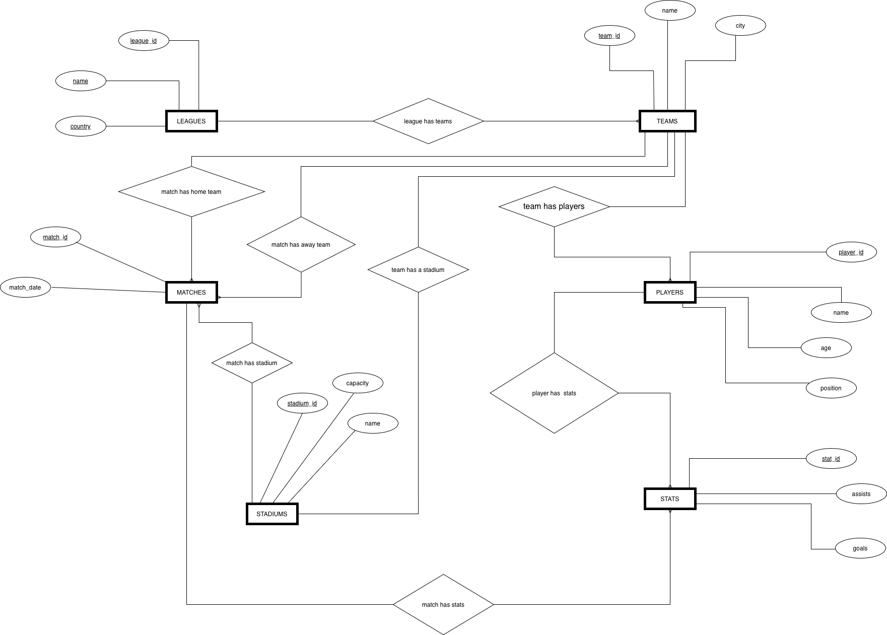
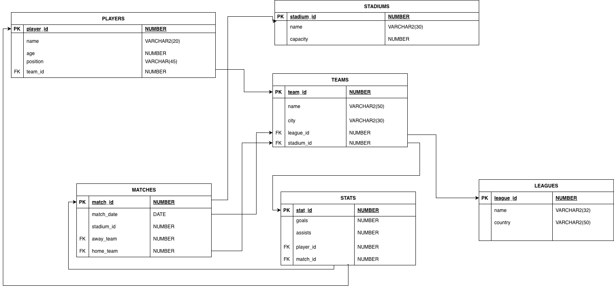
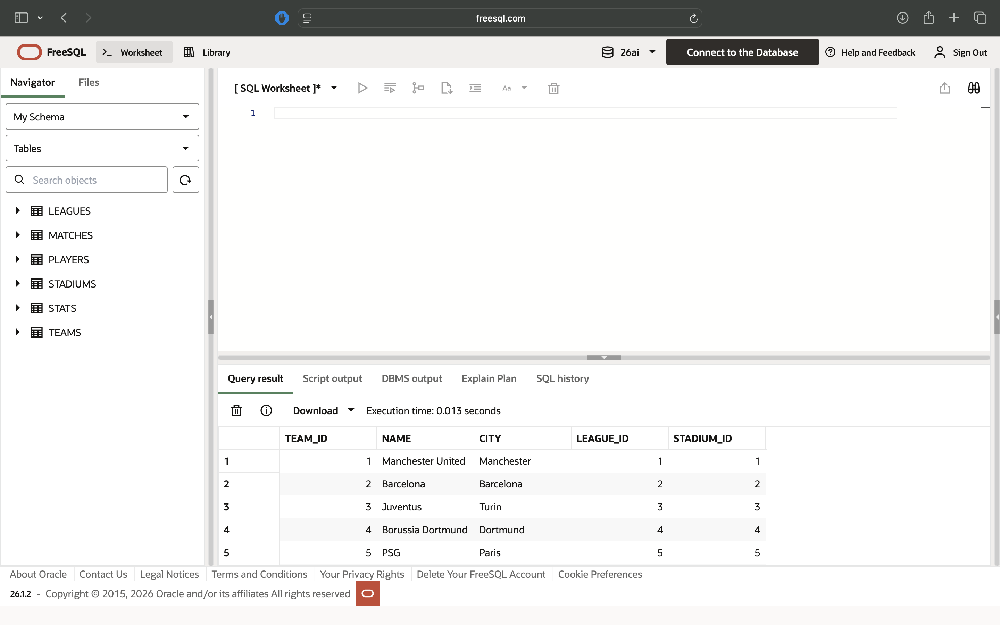

# Informačný systém pre futbalovú ligu (Oracle SQL)

Databáza futbalovej ligy navrhnutá od ER modelu až po pokročilé SQL objekty. Školský projekt z databázových systémov (FEI TUKE), vyskúšaný na Oracle FreeSQL.

## Dátový model
6 prepojených tabuliek: `Leagues`, `Stadiums`, `Teams`, `Players`, `Matches`, `Stats` (primárne a cudzie kľúče, zápas má domáci aj hosťujúci tím).

| ER model | Relačný model |
|---|---|
|  |  |

## Čo skript obsahuje (`futbalova_liga.sql`)
- **Tabuľky a testovacie dáta** (po 15 záznamov v každej tabuľke).
- **Pohľady so vstavanými funkciami**: `UPPER`, `LENGTH`, `SUBSTR`.
- **JOIN-y** cez viac tabuliek (hráč → tím, tím → liga, zápas → štadión).
- **Agregácie**: `COUNT`, `AVG`, `GROUP BY` (počet a priemerný vek hráčov v tíme).
- **Množinová operácia** `UNION`.
- **Vnorené SELECTy**: hráči nad priemerným vekom, tímy s hráčmi.
- **Sekvencia + trigger**, ktorý automaticky dopĺňa `player_id`.
- **Trigger na kontrolu dát**: hráč mladší ako 15 rokov sa nevloží (`ORA-20001`).

## Spustenie
1. Otvor [Oracle FreeSQL](https://freesql.com) alebo vlastnú Oracle databázu.
2. Vlož obsah `futbalova_liga.sql` a spusti ho ako skript.
3. Vyskúšaj napríklad:
   ```sql
   SELECT * FROM view_player_team;
   SELECT * FROM view_avg_age;
   INSERT INTO Players (name, age, position, team_id) VALUES ('Test', 10, 'Forward', 1); -- zlyhá na triggeri
   ```


